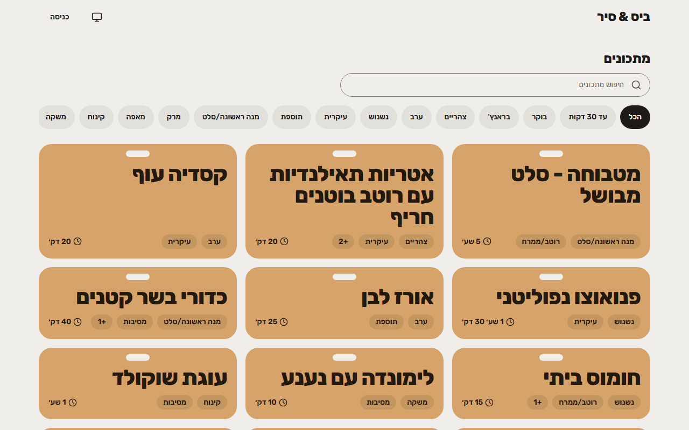
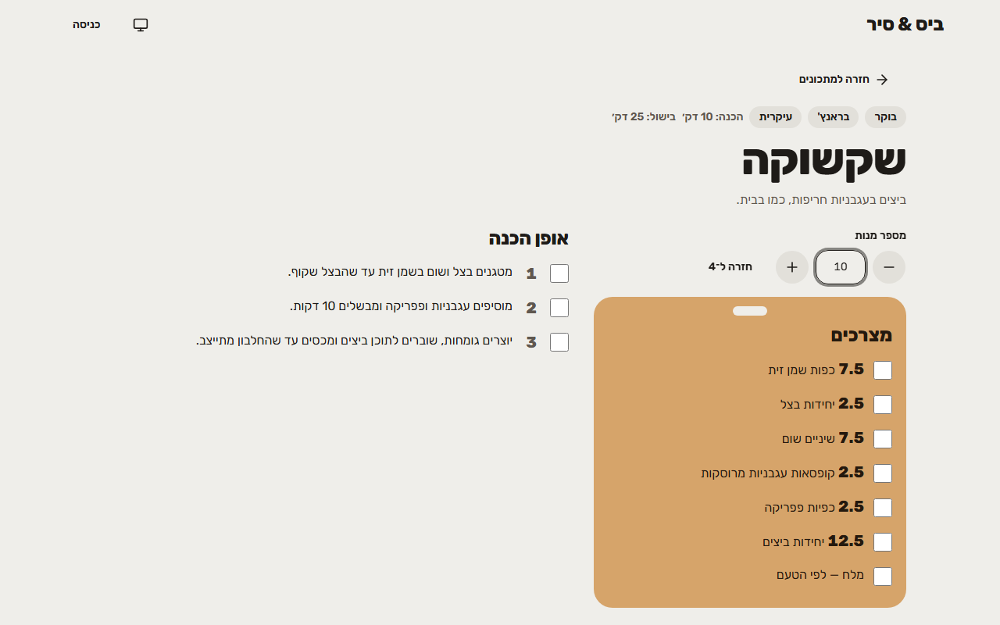
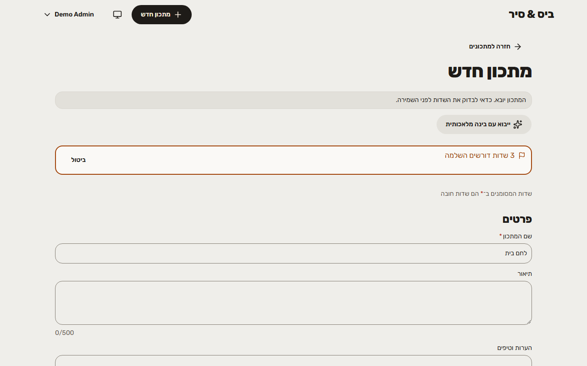
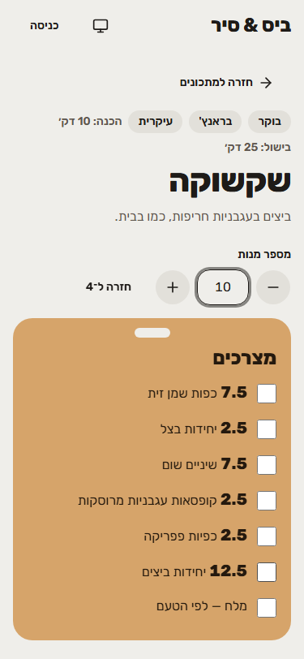
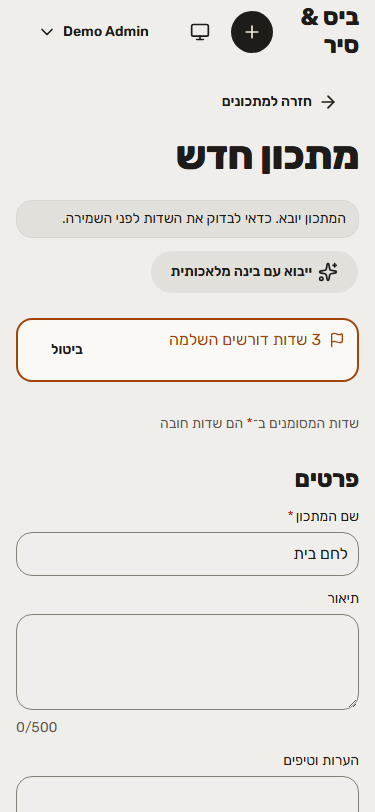
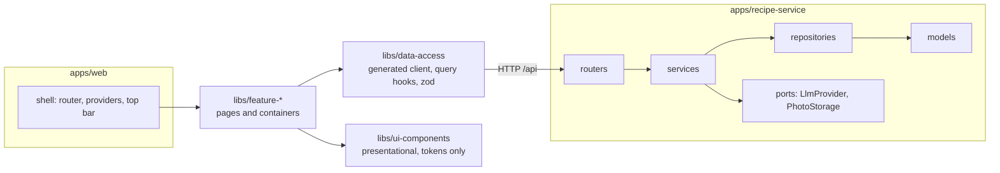

# Bite & Board (ביס & סיר)

A Hebrew, right-to-left recipe site where you add a recipe by pasting a link.

## TL;DR

**Paste a recipe URL and get a Hebrew draft to review.** That is the core idea. The app reads the page, uses its structured recipe data when it exists and an AI model for the rest, translates English recipes to Hebrew and converts imperial units, then opens the draft in the normal recipe form for you to review. If a site blocks the fetch or has no usable recipe, there is a semi-automatic fallback: paste the page's text and the same pipeline builds the draft. Nothing is saved until you press Save, and missing fields are flagged instead of invented.

- **The rest of the app:** a recipe library anyone can browse. Visitors search, filter by tags and scale a recipe to any number of servings. Editors (and the admin) create, edit and delete recipes, manage tags and photos, and use the AI import.
- **Stack:** React 19, Vite, TypeScript, Tailwind CSS and shadcn/ui on the front end. FastAPI, SQLAlchemy, Alembic and SQLite on the back end. One Nx monorepo.
- **Worth a look:**
  - **AI import done carefully.** Live progress that can be cancelled. Models sit behind one provider port (Claude Haiku by default, Gemini as an option, a fake one for tests, so CI never calls a model). Unit conversion is plain code, not model arithmetic. URL fetches refuse private addresses and oversized pages.
  - **Tested at every layer.** Unit tests (Vitest for the front end and shared libs, pytest for the domain and service rules), integration tests (pytest drives every API endpoint through FastAPI's `TestClient` against a real temporary SQLite database with migrations applied), component tests, and end-to-end tests (Playwright in a real browser, plus axe accessibility checks). CI runs all of it on every pull request, and no test ever calls a real AI model.
  - **Original-value tracking.** Change an ingredient's amount and the recipe keeps the first saved value, shown as "originally 1 tsp", scaled along with the recipe.
  - **One contract, no drift.** The backend's OpenAPI schema generates the TypeScript client, query hooks and Zod schemas. CI fails if the generated code is stale.
  - **Enforced architecture.** Backend layers (router, service, repository) are checked by an import linter, and frontend dependency direction by Nx module-boundary rules.
  - **Hebrew RTL and accessibility first.** A design system built on tokens only, a Storybook for the shared components, and axe accessibility checks in the end-to-end tests.
  - **Built with AI, deliberately.** See [Built with AI](#built-with-ai).

## Contents

- [Screenshots](#screenshots)
- [Features](#features)
- [Run it locally](#run-it-locally)
- [Configuration](#configuration)
- [Architecture at a glance](#architecture-at-a-glance)
- [Tech stack and why](#tech-stack-and-why)
- [Quality gates](#quality-gates)
- [Built with AI](#built-with-ai)
- [Project documents](#project-documents)

## Screenshots

Hebrew, right to left, on the demo data. Left to right in each row: the library, a recipe scaled to 10 servings, and a pasted-text import that opened a draft for review (the import shots use the built-in test engine, so the recipe is a canned one).

Desktop:

<p>
  
  
  
</p>

Mobile:

<p>
  
  
  
</p>

## Features

- **Library:** recipe cards with title, tags, total time and photo; search by title; filter by tags (all selected tags must match) with pinned tags as quick-filter chips. Search and filters survive navigating to a recipe and back.
- **Recipe page:** ingredients and numbered steps, notes, source link for imported recipes. Scale servings from 1 to 100 instantly in the browser; "to taste" ingredients never scale, and unit-type ingredients (eggs, cloves) show as familiar fractions.
- **Editing:** one form for create and edit, with inline validation, reorderable ingredients and steps, tag autocomplete with inline new tags, one photo per recipe, and a prompt before leaving unsaved changes.
- **Original quantities:** the first time an ingredient's amount or unit changes, the original is stored and shown as a quiet hint.
- **AI import:** from a URL or pasted text, into a draft you review in the normal form. Structured data on the page (schema.org `Recipe`) is used first and the model only fills the gaps. Missing fields are flagged instead of invented.
- **Roles:** visitor (read only), editor, admin. There is no sign-up page: the admin is created from the command line and creates other users. Cookie sessions, rate-limited login, blocked users stop working on their next request.
- **Tags and users screens** for managing the tag list and the people who can edit.

## Run it locally

### Prerequisites

- Node.js 22.22 or newer, with npm
- [uv](https://docs.astral.sh/uv/) (installs and manages the Python version the back end needs)

`npm run dev` runs everything.

### Quick start

```bash
# 1. Install the front end dependencies
npm ci

# 2. One-time setup: installs the back end (Python via uv), creates
#    apps/recipe-service/.env with a random JWT_SECRET, and creates an admin
#    account (the password is printed once)
npm run setup

# 3. Start the front end (http://localhost:4200) and the API (http://localhost:8000)
npm run dev
```

On its first start the API creates the database, runs the migrations and loads about ten demo recipes, so the library is not empty. Open <http://localhost:4200> and log in with the account that `npm run setup` printed.

The only thing you add yourself is your AI key: put `ANTHROPIC_API_KEY=...` in `apps/recipe-service/.env` to use the AI import. To try imports without a key, run `npm run setup -- --fake-ai` (it uses the built-in test engine, which returns a canned recipe). `npm run setup` is safe to run again: it never changes an existing `.env` or admin. Options: `--email <address>` and `--name <display name>` for the admin.

### Doing it by hand

If you prefer not to use the script:

```bash
cd apps/recipe-service && uv sync && cd ../..
cp apps/recipe-service/.env.example apps/recipe-service/.env   # then set JWT_SECRET
npm run create-admin -- --email you@example.com --name "Your Name"   # asks for a password, twice
```

To refill the dev database with the demo recipes later, run `npm run db:mock-recipes`.

### Everyday commands

Run from the repository root. They wrap `nx`.

| Script            | What it does                                                                                           |
| ----------------- | ------------------------------------------------------------------------------------------------------ |
| `dev`             | Front end (`localhost:4200`) and back end (`localhost:8000`) together                                  |
| `dev:web`         | Front end only                                                                                         |
| `dev:api`         | Back end only                                                                                          |
| `storybook`       | Component workshop for `libs/ui-components` (`localhost:6006`)                                         |
| `test`            | Run every test, front end and back end                                                                 |
| `e2e`             | End-to-end tests in a real browser                                                                     |
| `verify`          | Lint, type-check, test and build everything, like CI                                                   |
| `prettify`        | Tidy the formatting of all files (Prettier for the front end, ruff for the back end)                   |
| `api:types`       | After a back-end API change: export the OpenAPI schema and regenerate the client in `libs/data-access` |
| `db:mock-recipes` | Fill the dev database with a set of demo recipes                                                       |
| `create-admin`    | Create the admin account                                                                               |
| `setup`           | First-time setup: back end install, `.env`, admin account                                              |

### Storybook

The shared UI components in `libs/ui-components` have a Storybook, with an RTL decorator, a light/dark toggle and an accessibility panel:

```bash
npm run storybook
```

It opens at <http://localhost:6006>. The Storybook is not published online.

## Configuration

Settings are environment variables, read once by the API (pydantic-settings). Locally they come from `apps/recipe-service/.env`, which is gitignored. [`.env.example`](apps/recipe-service/.env.example) documents every setting. The ones you will touch:

| Variable            | Meaning                                                                                                             |
| ------------------- | ------------------------------------------------------------------------------------------------------------------- |
| `JWT_SECRET`        | **Required.** Signs session cookies. The API refuses to start without it. The `.env.example` shows how to make one. |
| `ENV`               | `dev` or `production` (the default when unset, the safe choice).                                                    |
| `DATA_DIR`          | Folder for the SQLite database and uploaded photos.                                                                 |
| `COOKIE_SECURE`     | Send the session cookie only over HTTPS. `false` is allowed only with `ENV=dev`.                                    |
| `LLM_PROVIDERS`     | The import engine: `anthropic` (default), `gemini`, or `fake` (tests and CI only).                                  |
| `ANTHROPIC_API_KEY` | Needed for the default engine. Without a key, imports return a readable error; the rest of the app works.           |
| `GEMINI_API_KEY`    | Needed only when `LLM_PROVIDERS=gemini`.                                                                            |
| `IMPORT_DAILY_CAP`  | Imports allowed per day across all users (default 50).                                                              |

To try imports without an API key, set `LLM_PROVIDERS=fake`.

## Architecture at a glance

A **modular monolith**: one FastAPI service and one React single-page app in one Nx workspace. The browser talks to a single origin; in development the Vite dev server proxies `/api` and `/media` to FastAPI, so cookies need no CORS setup.



Key decisions (the full list, with the reasoning, is in the architecture spine):

- **Feature modules with one-way layers.** The back end is split by feature (`recipes`, `tags`, `auth`, `users`, `imports`, `photos`), each layered router, service, repository, models. A module uses another only through its service.
- **Thin app, thick libs.** `apps/web` is only the shell. Pages and data-fetching containers live in `libs/feature-*`; `libs/ui-components` is purely presentational (props in, callbacks out).
- **OpenAPI is the only contract.** The API schema generates the client, so front end and back end cannot drift.
- **The recipe is one aggregate.** A recipe, with its ingredients and steps (stored as JSON inside the recipe row), is read and written in one transaction, and only one service applies the original-value rule.
- **AI behind a port.** The model sits behind a `LlmProvider` interface. Output is validated against one schema with one retry. Tests never call a real model.
- **Safe imports.** Outbound fetches refuse private addresses, cap page size and time, and never bypass bot protection.
- **Schema changes only through Alembic**, applied on start.

### How the API contract flows (Pydantic to React)

The front end never hand-writes API types or fetch calls. They are generated from the back end, at development time (nothing is generated while the app runs):

1. **FastAPI describes itself.** Pydantic models and type hints (`def list_tags(...) -> list[TagRead]`) become the OpenAPI schema. `generate_operation_id` in `app/main.py` names each operation `{tag}_{function}` (for example `tags_list_tags`), so generated names stay stable.
2. **Export the schema.** `app/openapi_export.py` builds the app without starting a server and writes `libs/data-access/openapi.json`, with sorted keys so a diff appears only when the API really changes (Nx target `recipe-service:openapi`).
3. **Generate the client.** `nx run data-access:generate` (depends on step 2) runs hey-api with `libs/data-access/openapi-ts.config.ts` and writes `libs/data-access/src/generated/`:
   - `types.gen.ts`: TypeScript types (`TagRead`)
   - `client.gen.ts`, `sdk.gen.ts`: fetch functions (`tagsListTags()`)
   - `@tanstack/react-query.gen.ts`: query options, query keys and mutations (`tagsListTagsOptions()`, `tagsCreateTagMutation()`)
   - `zod.gen.ts`: runtime validation schemas (`zTagRead`)
4. **Use it in React.** `libs/data-access` re-exports the generated code and adds the shared client setup (CSRF header, 401 handling). Feature libs only call `useQuery(tagsListTagsOptions())`, and forms validate with the generated Zod schemas.
5. **CI keeps it honest.** CI runs the generator again and `git diff --exit-code`. If the back end changed and the client was not regenerated, the build fails.

When you change a back-end model or endpoint, run `npm run api:types` and commit the regenerated files with the change.

## Tech stack and why

| Area          | Choice                                  | Why                                                                                     |
| ------------- | --------------------------------------- | --------------------------------------------------------------------------------------- |
| Monorepo      | Nx                                      | One place for both apps and the shared libs, task caching, module-boundary enforcement. |
| Front end     | React 19, Vite, TypeScript              | A fast SPA with a typed codebase.                                                       |
| Styling       | Tailwind CSS 4, shadcn/ui (Radix)       | Design tokens in one place, accessible primitives.                                      |
| Server state  | TanStack Query                          | Caching and invalidation instead of hand-written fetch state.                           |
| Routing       | React Router                            | Lazy-loaded routes, so visitors do not download the editor code.                        |
| Forms/schemas | Zod (generated from OpenAPI)            | The same validation rules on both sides.                                                |
| i18n          | i18next, Hebrew only                    | All strings in one dictionary, RTL by default.                                          |
| Back end      | Python 3.13, FastAPI, Pydantic v2       | Typed request and response models that produce the OpenAPI schema.                      |
| Database      | SQLite, SQLAlchemy 2, Alembic           | Zero setup for a small app, with real migrations.                                       |
| AI            | Claude Haiku (default), Gemini (option) | Cheap, fast extraction; swapped with one setting.                                       |
| HTML parsing  | BeautifulSoup                           | Reads structured recipe data and page text for URL imports.                             |
| Tests         | Vitest, pytest, Playwright, axe-core    | A test layer per concern, see below.                                                    |
| Components    | Storybook 10                            | Shared components are built and checked in isolation.                                   |

## Quality gates

Every pull request runs the same checks in GitHub Actions (`.github/workflows/ci.yml`), and `npm run verify` runs most of them locally:

- **Generated client is fresh:** regenerates the API client and fails on any diff.
- **Formatting:** `nx format:check` (Prettier, plus ruff on the back end).
- **Lint and type-check:** ESLint with Nx module boundaries and jsx-a11y; TypeScript; ruff, mypy and an import linter for the back end.
- **Unit and integration tests:** Vitest for the front end and shared libs (unit and component tests). pytest for the API: unit tests of the services, and integration tests that call each endpoint through `TestClient` against a real temporary SQLite database.
- **End-to-end tests:** Playwright drives a real browser against a real API on a temporary database with the fake AI provider. It covers opening and scaling a recipe, and logging in to import, complete and save one, at 375 px and at desktop width. An axe accessibility check runs on the library, detail and form pages.
- **Build and Storybook build** of everything affected.

Performance budgets (bundle size, Lighthouse) are planned but not in place yet.

## Built with AI

This project was built with Claude Code, and the way it was used is part of what it shows.

- **Plan first.** The product requirements, UX design, architecture spine and the epics and stories were produced with the BMAD method before any feature code. Each feature is a story with acceptance criteria, tracked in `_bmad-output/implementation-artifacts/sprint-status.yaml`.
- **A human decides.** Architecture decisions (libraries, structure, schema, AI provider) are proposed as options with a recommendation and made by the developer. Nothing is committed or pushed until the developer has reviewed the change.
- **Models matched to the task.** [`docs/ai-model-playbook.md`](docs/ai-model-playbook.md) sets which Claude model and effort to use per kind of work, favoring cost efficiency and escalating only when needed.
- **AI inside the product is tested without a model.** The import feature runs against a fake provider in tests and CI, so the suite is deterministic and free.
- **Review artifacts are kept.** Review notes and "what changed and why" summaries per story are stored beside the sprint status.

## Project documents

- [Architecture spine](_bmad-output/planning-artifacts/architecture/architecture-recipes-2026-10-26/ARCHITECTURE-SPINE.md): the decisions and rules the code follows.
- [Product requirements](_bmad-output/planning-artifacts/prds/prd-recipes-2026-10-26/prd.md) and its [addendum](_bmad-output/planning-artifacts/prds/prd-recipes-2026-10-26/addendum.md)
- UX: [DESIGN.md](_bmad-output/planning-artifacts/ux-designs/ux-recipes-2026-10-26/DESIGN.md) (how it looks) and [EXPERIENCE.md](_bmad-output/planning-artifacts/ux-designs/ux-recipes-2026-10-26/EXPERIENCE.md) (how it behaves)
- [Epics and stories](_bmad-output/planning-artifacts/epics.md)
- [Back end guide](apps/recipe-service/README.md)
- [AI model playbook](docs/ai-model-playbook.md)
