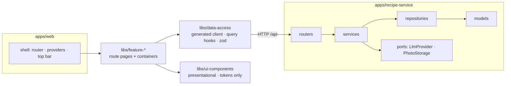
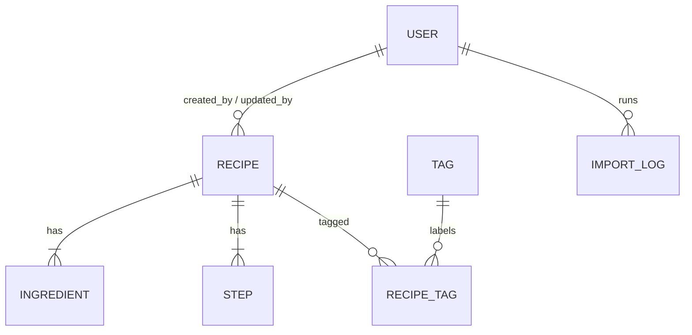

# Architecture Spine — Bite & Board

## Design Paradigm

**Modular monolith.** There is one FastAPI service and one React SPA, both inside the Nx workspace. The backend is split by **feature module**. Each module is layered `router → service → repository → models/schemas`, much like a NestJS module: router = controller, service = provider, and FastAPI `Depends()` = DI. The frontend follows Nx's "thin app, thick libs": `apps/web` is only the shell (router, providers, top bar). Each feature's pages and **containers** (routes, data, side effects) live in a `libs/feature-<name>` library, and **presentational** components live in `libs/ui-components`.



## Invariants & Rules

### AD-1 — Feature modules with one-way layers [ADOPTED]

- **Binds:** apps/recipe-service
- **Prevents:** routers that query the DB directly, and modules that reach into each other's tables.
- **Rule:** The modules are `recipes`, `tags`, `auth`, `users`, `imports` and `photos`, under `app/<module>/`, plus shared `app/core` (config, db session, errors, security). Dependencies only point down: router → service → repository → models. A module calls another module only through its **service**, never through its repository or models. Routers contain no business logic.

### AD-2 — Frontend dependency direction [ADOPTED]

- **Binds:** apps/web, libs/*
- **Prevents:** presentational components that fetch data, and hand-rolled API calls.
- **Rule:**
  - Feature libraries are `libs/feature-recipes` (library, detail, editor), `feature-auth` (login, account), `feature-users`, `feature-tags` and `feature-import`. The first story that needs one creates it.
  - `apps/web` holds only the shell (router, providers, app-wide layout). It lazy-loads pages from feature libs and may also import `libs/data-access` (the query client provider and the 401 handler), `libs/ui-components` (the shell's own UI) and `libs/recipe-domain`.
  - A feature lib may import `data-access`, `ui-components` and `recipe-domain`, but never another feature lib.
  - `libs/ui-components` imports neither the API nor any global state: props in, callbacks out, design tokens only (DESIGN.md).
  - `libs/i18n` holds `he.json`, the i18next init and the typed keys. The app and feature libs may import it; it imports no workspace project. `libs/ui-components` may not import it or i18next: strings come in as props (Story 1.4).
  - Every server call goes through `libs/data-access`.
  - Nx module-boundary tags enforce this.

### AD-3 — OpenAPI is the only contract [ADOPTED]

- **Binds:** NFR-8, all API work
- **Prevents:** frontend types drifting from the backend.
- **Rule:** FastAPI's OpenAPI schema is the source of truth. **hey-api openapi-ts** generates the TypeScript types, the fetch client, the TanStack Query hooks and the Zod schemas into `libs/data-access/src/generated` (never hand-edited). Generation is an Nx target, and CI fails if the generated output is stale.

### AD-4 — The recipe is one aggregate [ADOPTED]

- **Binds:** F2–F6, F10, FR-7–9
- **Prevents:** two writers of ingredients, and the original-value rule implemented in two places.
- **Rule:** `GET/POST/PUT /api/recipes[/{id}]` read and write the **whole** recipe in one transaction: fields, ordered ingredients, ordered steps, tag ids and photo key. PUT replaces the full aggregate. Existing ingredients keep their `id`; new ones have none. Only `recipes.service` applies FR-7–9:
  - On the first change to an existing ingredient's amount or unit, it stores `original_amount/original_unit`.
  - If the amount and unit are set back to equal the original, it clears both original fields (this is "reset to original").
  - New ingredients never get originals.

  The client never sends original fields.

### AD-5 — Identifiers are UUIDs [ADOPTED]

- **Binds:** every entity and every API path
- **Prevents:** mixed id types, and enumerable URLs.
- **Rule:** Every entity id is a UUID (v4), generated server-side, and exposed as a string in JSON and URLs.

### AD-6 — Cookie auth, same origin [ADOPTED]

- **Binds:** F8, FR-16, NFR-10
- **Prevents:** tokens in JS-readable storage, and per-route ad-hoc auth checks.
- **Rule:**
  - Login sets a signed JWT in an `httpOnly; Secure; SameSite=Lax` cookie with a 7-day expiry.
  - The SPA and API are always served from **one origin**: the Vite proxy in dev, a single host in prod.
  - Every mutating route depends on one `require_role(...)` dependency (AD-30). It returns 401 without a valid session and 403 when the role is too low.
  - Mutations also require the header `X-Requested-With: bite-and-board` as a CSRF guard.
  - The client handles a 401 in one place by redirecting to `/login?next=…`.
  - Passwords are hashed with Argon2id via pwdlib. The first admin is created by CLI only (AD-30).
  - Login is rate-limited (5 per minute).

### AD-7 — Tags are one flat list [ADOPTED]

- **Binds:** F1, F10
- **Prevents:** two taxonomies with two APIs, and duplicate tags.
- **Rule:** `tag(id, name, pinned, sort_order)` is unique on `lower(name)`, and `recipe_tag(recipe_id, tag_id)` links it to recipes. There are no tag groups and no meal types: a recipe has any number of tags (0..n), and none is required. `pinned` tags are the quick-filter chips in the library, shown in `sort_order`; unpinned tags have no `sort_order`. Only `tags.service` creates, renames, pins or deletes tags. Deleting a tag detaches it from all recipes.
- **Supersedes:** the earlier "one table with `group`, exactly one meal type per recipe" rule (Adi, 2026-10-27).

### AD-8 — State ownership on the client [ADOPTED]

- **Binds:** apps/web
- **Prevents:** server data copied into stores, and filter state that is lost on navigation.
- **Rule:**
  - **Server data:** TanStack Query only, through the generated hooks.
  - **Client state:** React Context plus hooks, for the auth session view and the theme only. Zustand is added only on a proven need.
  - **List filters:** live in the **URL** (`?q=&tags=`).
  - **Scaling:** local component state, never persisted (FR-11).

### AD-9 — Forms and errors [ADOPTED]

- **Binds:** FR-4, FR-6, FR-19, FR-22
- **Prevents:** divergent validation rules and error shapes.
- **Rule:** Forms use React Hook Form with the generated Zod schemas, plus `useFieldArray` for ingredients and steps. The API returns FastAPI's standard 422 shape (`detail[].loc/msg/type`). The client maps it onto fields with one shared helper. Non-field errors use `{detail: string}`.

### AD-10 — Hebrew RTL and i18n [ADOPTED]

- **Binds:** NFR-12, all UI
- **Prevents:** hard-coded strings, and left/right layout that breaks under RTL.
- **Rule:**
  - Set `<html lang="he" dir="rtl">` and use Radix `DirectionProvider`.
  - Every UI string is an i18next key in `he.json`.
  - Use only Tailwind logical utilities (`ms/me/ps/pe/start/end`); lint bans `ml-/mr-/pl-/pr-/left-/right-`.
  - Wrap amount+unit pairs in `<bdi>`.

### AD-11 — Routing and rendering [ADOPTED]

- **Binds:** apps/web, NFR-11
- **Prevents:** eager bundles that ship editor or import code to visitors.
- **Rule:** React Router v8 with **lazy** route modules per page (like Angular `loadChildren`). Each page is its own subpath export of its feature lib (for example `@bite-and-board/feature-recipes/library`), so lazy-loading one page never pulls in the rest of the lib. Signed-in routes (edit, new, import, tags, users, account, login) live in their own chunks. The React Compiler is enabled; hand-written `useMemo`/`useCallback` only with a measured reason.

### AD-12 — AI providers behind one port [ADOPTED]

- **Binds:** F9, FR-17–21, FR-24
- **Prevents:** provider SDKs leaking into business code, and saved drafts.
- **Rule:**
  - `imports` depends only on the `LlmProvider` Protocol: `extract(source) -> DraftRecipe`.
  - Adapters are registered **by name** in a provider registry, enabled from config:
    - `ollama`: local, the default for now.
    - `gemini`: free tier, the optional backup.
    - `fake`: used by tests and CI, which never call a real model.
  - The import dialog lists the enabled providers and offers a one-click "retry with Gemini".
  - Every provider returns schema-constrained JSON, validated against the shared Pydantic `DraftRecipe`. The draft is Hebrew-translated, has units mapped to the app list, and suggests tags from the existing list (new tag names are proposed in the draft).
  - An import is **one synchronous request** with a per-provider timeout (`ollama` ≈ 180s, `gemini` 60s), and the client aborts it on cancel.
  - Drafts are **never persisted** (FR-19). A new provider means one adapter plus one config entry.

### AD-13 — Safe import pipeline [ADOPTED]

- **Binds:** FR-17, FR-18, NFR-10
- **Prevents:** SSRF, runaway cost, and the LLM being used where structured data exists.
- **Rule:**
  - The pipeline order is fixed: safe fetch → schema.org JSON-LD extract → readable-text fallback → LLM.
  - The LLM always runs, for translation and mapping, but receives the JSON-LD when present.
  - Fetching only follows `http/https` to public addresses. It resolves DNS and rejects private, loopback and link-local addresses, including on every redirect. It caps size and time.
  - Imports require an editor session, with one daily import cap shared by all users and a `max_tokens` cap. Provider keys come from env only.

### AD-14 — Photos behind one port [ADOPTED]

- **Binds:** recipe photo (FR-1, FR-4, FR-5, FR-17, FR-19)
- **Prevents:** hotlinked images, and storage code spread across modules.
- **Rule:**
  - Only `photos.service` writes photos, through the `PhotoStorage` Protocol. The MVP adapter is local disk on the same persistent volume as the database.
  - Every stored photo is re-encoded as WebP at max 1600px plus a 600px thumbnail.
  - A recipe holds a nullable `photo_key`.
  - Imported photos are downloaded on **save**, not at import time, and their source domain is kept as credit.
  - Photos are served under `/media/…`.

### AD-15 — One container, one origin [ADOPTED]

- **Binds:** NFR-6, AD-6, AD-14, deployment
- **Prevents:** cross-origin cookie problems, and split deploy units drifting apart.
- **Rule:** The production image is a single container. FastAPI serves the built SPA (with fallback to `index.html` for client routes), `/api/*` and `/media/*`. The SQLite file and the photos live on one mounted volume (`/data`). `docker compose up` runs this image locally. Day-to-day dev is `npm run dev`: Nx runs `web` and `recipe-service` together, and Vite proxies `/api` and `/media` to FastAPI. Ollama runs as the native Windows app and is reached by URL from config.

### AD-16 — Tests per layer, never a real model [ADOPTED]

- **Binds:** NFR-1, NFR-2, all units
- **Prevents:** flaky shared-state tests, CI calling paid or slow models, and untested business rules.
- **Rule:**
  - **Backend:** pytest with FastAPI `TestClient` against a fresh temporary SQLite database per test. There are API tests for every endpoint. Unit tests for `recipes.service` give 100% branch coverage on the original-value rules.
  - **Frontend:** Vitest unit tests (scaling and rounding at 100% branch coverage). React Testing Library and MSW component tests (the recipe form). Playwright e2e for three flows: scale a recipe, edit with the original hint and reset, import with the `fake` provider. Storybook on `libs/ui-components` documents every shared component in RTL and both themes, with the a11y addon; `build-storybook` runs in CI (Story 1.5).
  - Tests and CI always use `LLM_PROVIDER=fake`.

### AD-17 — CI on plain GitHub Actions [ADOPTED]

- **Binds:** NFR-1, NFR-11
- **Prevents:** CI that silently skips the Python backend or depends on an unconnected service.
- **Rule:** One GitHub Actions workflow sets up Node and Python (uv), installs dependencies, and runs `nx affected -t lint typecheck test build e2e`, plus the OpenAPI-client drift check (AD-3) and the bundle-size budget (NFR-11). Nx Cloud is not used. It can be added later without changing targets.

### AD-18 — Schema changes only through Alembic [ADOPTED]

- **Binds:** recipe-service persistence, NFR-6
- **Prevents:** hand-edited databases, and schema drift between dev and the deployed volume.
- **Rule:** Every model change ships with an Alembic revision autogenerated from the SQLModel metadata and reviewed by hand. The app applies pending migrations on startup. Seed data (FR-12) is idempotent and runs only by explicit command.

### AD-19 — Contract details [ADOPTED]

- **Binds:** AD-3, all routers, libs/data-access
- **Prevents:** unstable generated hook names, hand-written query keys, and stale caches after writes.
- **Rule:**
  - **Operation IDs:** set by `generate_unique_id_function` as `{tag}_{function}`. Every router declares `tags=[<module>]`, and route functions are named `verb_noun`. A test asserts the IDs are unique and match the pattern.
  - **Schema export:** `recipe-service:openapi` writes `libs/data-access/openapi.json` (committed). `data-access:generate` depends on it. CI runs both, then `git diff --exit-code`.
  - **Client config:** the hey-api client is configured once, with `credentials: 'same-origin'` and the CSRF header on every non-GET request.
  - **Cache invalidation:** uses only the generated `*QueryKey()` helpers, through one invalidation map in `libs/data-access`:
    - a recipe write invalidates the list and that recipe's detail;
    - a tag write invalidates tags, the list and all details;
    - login and logout invalidate the session.
  - **Validation:** constraints live in Pydantic, so they flow into the generated Zod.

### AD-20 — Wire shapes of the recipe aggregate [ADOPTED]

- **Binds:** AD-4, F2–F6
- **Prevents:** lost originals on PUT, read and write schemas getting mixed up, and unit codes that drift between languages.
- **Rule:**
  - **Schemas:** API schemas are plain Pydantic (`RecipeCreate`, `RecipeUpdate`, `RecipeRead`, `RecipeSummary`, `DraftRecipe`), never SQLModel table classes. Write schemas use `extra="forbid"` and have no `original*` fields.
  - **Ingredients on PUT:**
    - The diff matches by ingredient `id` and updates in place.
    - An `id` from another recipe returns 422.
    - An omitted ingredient is deleted, and a row without an `id` is inserted.
    - Array order is the only order.
  - **Originals:** `IngredientRead.original` is `{amount, unit} | null`, and `{null, null}` means "originally to taste". Going from null to a value, or back, counts as a change. Name-only or note-only edits never create an original. Storage: `original_amount`, `original_unit` and a `has_original` flag, because two NULLs alone could not tell "originally to taste" from "no original".
  - **Units:** `Unit` is one Python `StrEnum` of the PRD's English codes, used by every schema including `DraftRecipe` and published as an OpenAPI enum.
    - Hebrew labels live only in `he.json` (`units.<code>_one/_other`), and a test checks that every code has its labels.
    - The countable set (`unit, clove, slice, can, package`, rounded to the nearest ½) is defined once beside the enum.
    - **Import conversion:** a deterministic table in the imports service (`oz→g`, `lb→g`, `fl oz→ml`, friendly rounding; cups and spoons unchanged) plus a °F→°C pass over step text (rounded to 5; a converted step keeps its pre-conversion text in `source_text`). It runs after the LLM returns, so the model never does the arithmetic, and it has its own unit tests. Everything is stored metric. A converted ingredient keeps `source_amount` and `source_unit` (`SourceUnit`: `oz`, `lb`, `fl_oz`), kept apart from the FR-7 `original`. The detail page shows originals only through the "הצג מתכון מקורי" toggle, for recipes that have any. There is no metric/imperial display setting, so the table needs no TypeScript twin.
  - **Read shapes:** read schemas embed `tags: [{id, name}]`, ordered by `sort_order` (pinned first) and then name.
  - **Concurrency:** for the MVP, the last write wins [ASSUMPTION].

### AD-21 — Session endpoints and 401 handling [ADOPTED]

- **Binds:** AD-6, F8, FR-15, FR-16
- **Prevents:** anonymous visitors being redirected to login, login errors swallowed by the 401 handler, and a cookie that can't be cleared.
- **Rule:**
  - `GET /api/auth/session` is public and always returns 200 `{user: {id, email, name, role} | null}`.
  - `POST /api/auth/login` returns 400 `invalid_credentials`, and 429 when rate-limited.
  - `POST /api/auth/logout` clears the cookie.
  - A missing CSRF header gets 403, never 401.
  - The single 401 interceptor in `libs/data-access` fires only for calls that require a session. It navigates through the router, so in-memory form data survives.
  - Signed-in routes use a loader guard (and `/users` also checks the admin role) that redirects to `/login?next=`.
  - `COOKIE_SECURE` defaults to true. It may be false only when `ENV=dev`, for phone testing over the LAN.

### AD-22 — Import contract [ADOPTED]

- **Binds:** AD-12, FR-17–21, FR-24
- **Prevents:** the client aborting slow local imports, error states that can't be told apart, and drafts leaking into the URL.
- **Rule:**
  - **Timeouts:** `GET /api/imports/providers` (editor) returns `[{name, timeout_s}]`. The client aborts at `timeout_s + 5`, which replaces the UX's flat 60 s. The Vite proxy and uvicorn timeouts are set above the largest provider timeout.
  - **Progress:** phase text is client-timed and cosmetic. There is no streaming in the MVP.
  - **Errors:** import failures never return 422. They use these codes: `fetch_blocked`, `fetch_failed`, `fetch_too_large`, `no_recipe_found`, `llm_timeout`, `llm_unavailable`, `llm_quota`, `llm_invalid_output`, `import_cap_reached`, `provider_unavailable`.
  - **Recipe text fields:** `description` (a short intro) and `notes` (free multi-line tips and remarks) are separate nullable text columns and schema fields, limited by Pydantic to 500 and 5,000 characters (the form shows a live counter). The UI shows `notes` as plain text with line breaks kept, never as HTML. `DraftRecipe` fills `description` from the source and leaves `notes` null unless the source has its own.
  - **Draft shape:** `DraftRecipe` has every field nullable, plus `missing_fields: list[str]` (the server is authoritative) and `photo_source_url`. Its tags use the AD-25 tag reference.
  - **Draft hand-off:** the draft reaches the form only through router state, never the URL, mapped by one `draftToFormValues()`. A reload with no state shows an empty form.
  - **Form values:** the form has its own `RecipeFormValues` type (the amount is a string, so it can hold "½"). Exactly two pure functions convert to and from it: `toFormValues()` and `toWritePayload()`. The second is validated by the generated write Zod.

### AD-23 — Every outbound fetch is safe [ADOPTED]

- **Binds:** AD-13, AD-14
- **Prevents:** SSRF through imported photo URLs, and unbounded downloads.
- **Rule:** Every server-side fetch of a user-supplied or page-supplied URL goes through `app/core/safe_fetch.py`. It follows AD-13's rules (public addresses only, re-checked on each redirect, size and time caps) and checks the content type. It is a port, replaced by a fake fetcher when `LLM_PROVIDERS=fake`. The fake is deterministic by input (`fake://<fixture>`, `FAKE:<scenario>`) and refuses to start when `ENV=production`.

### AD-24 — Persistence and bootstrap [ADOPTED]

- **Binds:** AD-18, F7, F10, NFR-6
- **Prevents:** a fresh database that can't save a recipe, silent no-op cascades, duplicate tags, and timezone shifts.
- **Rule:**
  - **SQLite settings:** `app/core/db` sets `PRAGMA foreign_keys=ON` and `journal_mode=WAL` on every connection. Child rows use `ON DELETE CASCADE`. Alembic uses `render_as_batch=True`. Tests run `alembic upgrade head`.
  - **Default pinned tags:** 13 tags (בוקר … רוטב/ממרח) created by an Alembic data migration, with fixed UUIDs, Hebrew names, `pinned=true` and a `tag.sort_order` (0-12) that keeps their display order.
  - **Migrations:** `app/migrations/` (inside the package), `alembic.ini` at the project root for the CLI, and `app/core/migrate.py` applies `upgrade head` from the FastAPI lifespan.
  - **Demo seed:** goes through services only (create, then update, to produce an original). It is idempotent by recipe title and never creates the default tags.
  - **CLI:** one entry point, `python -m app.cli seed|create-admin|backup`, exposed as Nx targets.
  - **Time:** timestamps are UTC and always serialized with `Z`. The daily import cap resets at midnight in `APP_TIMEZONE` (default `Asia/Jerusalem`).
  - **Tag names:** `tags.service` normalizes them (NFC, trim, collapse spaces, max 40 characters) before comparing or storing.

### AD-25 — Tags in a recipe save [ADOPTED]

- **Binds:** AD-7, FR-22, FR-24
- **Prevents:** orphan tags from cancelled forms, half-saved imports, and a recipes ↔ tags import cycle.
- **Rule:**
  - Recipe writes carry `tags: [{id} | {name}]`.
  - `recipes.service` resolves names through `tags.service.get_or_create` inside the recipe transaction. The recipe form never calls `POST /api/tags`; only `/tags` does.
  - The `tags` module owns `recipe_tag`. `recipes` depends on `tags`, and `tags` never imports `recipes`.
  - The module graph (`recipes → tags, photos`; `imports → tags`) is enforced by import-linter in lint.

### AD-26 — Library list [ADOPTED]

- **Binds:** F1, FR-1–3, NFR-3
- **Prevents:** one story paging on the server while another filters on the client.
- **Rule:**
  - `GET /api/recipes` returns all `RecipeSummary` items, unpaginated (a few hundred at most), sorted by `created_at desc, id`.
  - Search (case-insensitive substring on the title) and filtering (tags, with AND: a recipe must have all selected tags) run on the client over the cached list. This is one pure function, used with `useDeferredValue`.
  - URL params hold IDs: `?q=&tags=<uuid>,<uuid>`.

### AD-27 — Photo lifecycle [ADOPTED]

- **Binds:** AD-14, FR-4, FR-17, FR-19
- **Prevents:** two writers of `photo_key`, orphan files, and media paths built by the client.
- **Rule:**
  - `POST /api/photos` (editor) takes a multipart file, or `{source_url}` via AD-23, and returns an unattached `photo_key`.
  - The recipe save is the only way to attach or detach a photo. `recipes.service` calls `photos.service.attach/release` after commit, and unattached keys older than 24 h are swept at startup.
  - Read schemas return `photo: {url, thumb_url, credit_domain} | null`, built by the server.
  - Limits: JPEG, PNG or WebP, at most 10 MB, with a pixel-count guard. EXIF orientation is applied and then the metadata is stripped. The limits live in config and are exposed in OpenAPI.
  - The SPA fallback never answers `/api/*` or `/media/*`.

### AD-28 — Error codes, not server text [ADOPTED]

- **Binds:** AD-9, AD-10
- **Prevents:** English server text in the Hebrew UI, and clients parsing errors to pull out details such as counts.
- **Rule:**
  - Non-422 errors return `{detail, code, params?}`, where `code` is an `ErrorCode` StrEnum published in OpenAPI.
  - The client renders only `errors.<code>` from `he.json`.
  - 422 errors are mapped by `loc` + `type` to i18n keys.
  - A global Zod error map uses the same keys.

### AD-29 — Operational envelope [ADOPTED]

- **Binds:** NFR-1, NFR-6, NFR-10, operations
- **Prevents:** secrets in logs, unrecoverable data loss, and misconfigured environments.
- **Rule:**
  - **Logging:** Python `logging`, pretty in dev and JSON in prod, with request IDs and redaction of passwords, cookies and keys. Each import writes one `import_log` row (provider, ms, tokens, outcome), which also counts the daily cap.
  - **Config:** the env matrix lives in a committed `.env.example`: `ENV`, `DATA_DIR`, `JWT_SECRET` (the app fails fast if it is missing), `COOKIE_SECURE`, `LLM_PROVIDERS`, `OLLAMA_URL` (`host.docker.internal` under compose), `GEMINI_API_KEY`, `GEMINI_MODEL`, `IMPORT_DAILY_CAP`, `LLM_MAX_TOKENS`, `APP_TIMEZONE`, `LOG_LEVEL`.
  - **Health:** `GET /api/health` (moved from `/health`) is the container `HEALTHCHECK`. A failed startup migration exits non-zero.
  - **Backup:** `app.cli backup` runs `VACUUM INTO` and tars the photos, with a documented restore. Scheduling is deferred with the host.

### AD-30 — Users and roles [ADOPTED]

- **Binds:** F8, FR-13–16, FR-25–27, all protected routes
- **Prevents:** ad-hoc permission checks, a role string compared differently in each module, and a system with no admin left.
- **Rule:**
  - **Roles:** `user(id, email unique lower, name, role ∈ {editor, admin}, password_hash, is_blocked, created_at)`. A visitor is the absence of a session; there is no viewer role.
  - **Guards:** permissions are checked only through `require_role("editor")` (admin satisfies it) and `require_role("admin")`, which are FastAPI dependencies in `app/core/security` (like Nest guards with `@Roles`). The client hides controls by role, but the server is the authority.
  - **Accounts:** the first admin comes from `app.cli create-admin`. Every other account is created by an admin through the `users` module (`/api/users`, admin only). There is no public sign-up, and no emails are sent.
  - **Blocking:** a blocked user's session is rejected on the next request. The session cookie is checked against `is_blocked` and `role` on every protected request, so a demotion takes effect immediately.
  - **Last admin:** the last active admin can't be demoted or blocked (409 `last_admin`).
  - **Authorship:** recipes carry `created_by` and `updated_by` (user ids), set only by `recipes.service`. The library is shared, so every editor can edit every recipe.
  - **Import cap:** the daily import cap is global. `import_log` records the `user_id`.

### AD-31 — Quantities [ADOPTED]

- **Binds:** AD-4, AD-20, FR-7–9, FR-11
- **Prevents:** amounts typed as numbers on one side and strings on the other, and "reset to original" never matching thirds.
- **Rule:**
  - `amount` is stored as `NUMERIC` and quantized to 3 decimal places on input. It is serialized as a JSON **number** (a custom serializer from `Decimal`), and is either > 0 or `null` (to taste).
  - Every comparison for FR-7–9 uses the quantized values.
  - The client parses "½", "⅓" and "1/3" with the shared `parseAmount()` from AD-32.

### AD-32 — Shared recipe domain library [ADOPTED]

- **Binds:** F6, FR-8, FR-11, apps/web, libs/ui-components
- **Prevents:** rounding and scaling implemented twice, and the scaled hint drifting from the scaled amount.
- **Rule:** `libs/recipe-domain` (Nx tag `type:domain`) is pure TypeScript with no React and no IO. It holds `scaleAmount`, `formatAmount`, `parseAmount`, the countable-unit rule, and the library filter function (AD-26). The app and `libs/ui-components` may both import it, but it imports nothing from the workspace. The server never scales. It is held to 100% branch coverage.

### AD-33 — Enforcement tooling [ADOPTED]

- **Binds:** AD-1, AD-2, AD-10, NFR-1, NFR-7, NFR-11
- **Prevents:** rules that are followed only on the honour system.
- **Rule:**
  - **Python:** mypy (strict, with the pydantic plugin) is the `recipe-service:typecheck` target. import-linter contracts for AD-1 and AD-25 run in `lint`.
  - **Rate limit:** slowapi limits login attempts (in memory, which is fine for one container).
  - **Frontend boundaries:** Nx tags `type:app`, `type:feature`, `type:data-access`, `type:ui`, `type:domain` and `type:i18n` carry these dependency constraints:
    - app → feature, data-access, ui, domain, i18n
    - feature → data-access, ui, domain, i18n (never another feature)
    - ui → domain (i18next and react-i18next banned)
    - data-access → nothing
    - domain → nothing
    - i18n → nothing
  - **Copy:** ESLint bans Hebrew string literals and JSX text outside `he.json`; spec files are exempt.
  - **Styling:** ESLint rules ban physical-direction utilities, arbitrary Tailwind values, hex/rgb literals outside the theme, and the `style` prop in `libs/ui-components`. They also cover jsx-a11y and the React hooks rules version the compiler needs.
  - **Bundle size:** size-limit checks the initial JS (≤ 200 KB gzip) as `web:size` in CI.
  - **Recipe pages:** recipe-scrapers (JSON-LD) and trafilatura (readable text) parse imported pages.
  - **React Compiler:** wired through the official Babel plugin (`babel-plugin-react-compiler`) via the Vite plugin chain.

## Brownfield ratification

- `apps/recipe-service/app/api|db|models` (the layer-first scaffold) move into the AD-1 feature layout. `db` becomes `app/core/db.py`, `health` moves to `app/core`, and the models move into their modules. `app/core/metadata.py` imports all models for Alembic.
- `react-router-dom@6.30.3` is replaced by `react-router@8` (data mode), installed by hand because Nx 24's React generators know only v6 and v7.
- Root `package.json` gets `"dev": "nx run-many -t serve -p recipe-service web"`.
- An `apps/web-e2e` Playwright project boots the API with `LLM_PROVIDERS=fake` on a temporary `DATA_DIR`.
- CI uses `nrwl/nx-set-shas` and `astral-sh/setup-uv`.
- `apps/recipe-service` moves from Python 3.12 to 3.13 (`.python-version`, `requires-python`), and adds `pydantic-settings` and runtime `httpx`.

## Consistency Conventions

| Concern       | Convention                                                                                                                                                                                                                                                                                         |
| ------------- | -------------------------------------------------------------------------------------------------------------------------------------------------------------------------------------------------------------------------------------------------------------------------------------------------- |
| API paths     | `/api/<plural-noun>`, kebab-case. JSON fields are snake_case on the wire, and the generated client uses them as-is.                                                                                                                                                                                |
| Timestamps    | UTC ISO-8601 (`created_at`, `updated_at`)                                                                                                                                                                                                                                                          |
| Errors        | 422 validation; 400 bad input or credentials; 401 no session on a protected call; 403 CSRF or insufficient role; 404 missing; 409 conflict (duplicate tag name); 413 upload too large; 429 rate limit or import cap; 502/504 provider failure or timeout. Body shape per AD-28 |
| Python naming | modules `snake_case`; schemas `RecipeCreate / RecipeRead / RecipeUpdate`                                                                                                                                                                                                                           |
| TS naming     | components `PascalCase.tsx`; hooks `useX`; route modules `libs/feature-<name>/src/routes/<page>.tsx`                                                                                                                                                                                               |
| Config        | env vars only, read once in `app/core/config` (pydantic-settings); no secrets in the repo                                                                                                                                                                                                          |
| Styling       | design tokens only (CLAUDE.md, NFR-7)                                                                                                                                                                                                                                                              |

## Stack

| Name                                                               | Version                                                                   |
| ------------------------------------------------------------------ | ------------------------------------------------------------------------- |
| Nx                                                                 | 24.0.0 [ADOPTED]                                                          |
| React / React DOM                                                  | 19.x [ADOPTED]                                                            |
| Vite                                                               | 8.x [ADOPTED]                                                             |
| TypeScript                                                         | ~6.0 [ADOPTED]                                                            |
| Vitest                                                             | ~5.0 [ADOPTED]                                                            |
| Python                                                             | 3.13 (moved from 3.12 at scaffold)                                        |
| FastAPI                                                            | ≥0.162 [ADOPTED]                                                          |
| SQLModel / Pydantic                                                | ≥0.0.48 / 2.x [ADOPTED]                                                   |
| Alembic                                                            | ≥1.20 [ADOPTED]                                                           |
| SQLite                                                             | embedded [ADOPTED]                                                        |
| React Router                                                       | 8.x (released 2026-06; replaces EOL 6.30)                                 |
| @tanstack/react-query                                              | 5.x                                                                       |
| @hey-api/openapi-ts                                                | 0.99.x (pre-1.0: pin exact)                                               |
| Zod                                                                | 4.x                                                                       |
| React Hook Form, i18next / react-i18next, Playwright, MSW          | current stable, pinned at scaffold                                        |
| Tailwind CSS / shadcn/ui                                           | 4.x / current CLI (RTL logical classes)                                   |
| pwdlib[argon2], PyJWT, httpx, Pillow                               | current stable, pinned at scaffold                                        |
| ollama (Python) / Ollama app                                       | 0.6.x / current                                                           |
| google-genai SDK                                                   | 2.x; Flash model name in config (`GEMINI_MODEL`, e.g. `gemini-3.8-flash`) |
| PyJWT                                                              | ≥2.13                                                                     |
| mypy, import-linter, slowapi, recipe-scrapers, trafilatura         | current stable, pinned at scaffold                                        |
| size-limit, babel-plugin-react-compiler, eslint-plugin-react-hooks | current stable (hooks ≥7 for compiler rules)                              |
| MSW                                                                | 3.x                                                                       |
| Storybook (`@nx/storybook`, React + Vite, addon-a11y)              | 10.x (10.6.4 pinned exactly in Story 1.5)                                 |

## Structural Seed



```text
apps/
  web/src/
    app/               # shell only: router, providers (query client, i18n, theme, auth context), top bar
  recipe-service/app/
    core/              # config, db, errors, security
    recipes/ tags/ auth/ users/ imports/ photos/   # each: router.py service.py repository.py models.py schemas.py
    imports/providers/ # ollama.py gemini.py fake.py registry.py
libs/
  feature-recipes/     # pages + containers: library, detail, editor (src/routes/<page>.tsx)
  feature-auth/        # login, account
  feature-users/ feature-tags/ feature-import/
  data-access/         # generated client + hooks + zod, query keys
  ui-components/       # shadcn-based presentational components, tokens only
  recipe-domain/       # pure TS: scale, format, parse, filter (AD-32)
```

## Capability → Architecture Map

| Capability                  | Lives in                                                     | Governed by        |
| --------------------------- | ------------------------------------------------------------ | ------------------ |
| F1 library, search, filters | libs/feature-recipes · recipes.router                        | AD-8, AD-7         |
| F2–F5 recipe CRUD           | recipes module · libs/feature-recipes                        | AD-1, AD-4, AD-9   |
| F4 original-value hints     | recipes.service                                              | AD-4               |
| F6 scaling                  | libs/recipe-domain                                           | AD-31, AD-32       |
| F8 users, roles, login      | auth + users modules · libs/feature-auth, libs/feature-users | AD-6, AD-21, AD-30 |
| F9 AI import                | imports module + providers · libs/feature-import             | AD-12, AD-13       |
| F10 tags                    | tags module · libs/feature-tags                              | AD-7               |
| Photos                      | photos module                                                | AD-14              |
| NFR-6 one-command run       | compose + nx dev target                                      | AD-15, AD-18       |
| NFR-1/2 quality, CI         | all projects                                                 | AD-16, AD-17       |
| NFR-12 RTL                  | web + ui-components                                          | AD-10              |

## Open

- **Default LLM provider:** `ollama` for now; confirm after the spike (about 5 real recipes, timing plus Hebrew quality).
- **Haiku adapter:** add when Adi buys credit (one adapter plus config). Writing it earlier is Adi's call.

## Deferred

- **Deployment host (PRD OQ-1):** after MVP. The constraint is set by AD-6 and AD-14: one origin plus a persistent volume for the SQLite file and photos.
- **S3-compatible photo storage:** add when deployed storage needs it, behind `PhotoStorage`.
- **Zustand:** add only on a proven client-state need.
